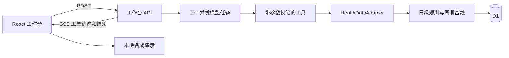

# Health Trend Journal
内容介绍：

    主要用于将如今的各种提供 API 功能的智能健康设备的身体数据可视化，可以上传给AI分析，AI会标注异常数值如睡眠评分差，心率数值异常等问题。
    提供模组化功能，如果是同为佳明用户可以直接照搬API相应的组件和登入组件，对于数据结构等个性化问题按照各自的需求和爱好进行设计不必全部照搬。
    
用个人基线观察睡眠、心率和活动量怎样随时间变化。趋势页支持近 30 天、90 天、半年、一年和全部历史。周均和月均曲线可以展开到触发偏离标记的具体日期。

**[打开交互演示](https://caojiawang69-commits.github.io/health-trend-journal/)** · **[模块使用手册](MODULES.md)** · [四种外部项目接入实测](MODULES.md#external-consumer) · [MIT 许可证](LICENSE)

按你要复用的功能进入手册：[登录组件](MODULES.md#login-ui) · [请求鉴权](MODULES.md#request-auth) · [密钥加密](MODULES.md#encryption) · [API 客户端](MODULES.md#api-client) · [图表数据结构](MODULES.md#chart-data) · [替换分析算法](MODULES.md#analysis)。

演示通过确定性函数生成四年数据。可以切换「睡眠与恢复」和「活动与消耗」，在橙色圆点对应的日期查看测量值、此前 28 天中位数和样本数。打开演示无需账户。

## 启动演示

使用 Node.js 22.13 或更高版本，在仓库根目录运行：

```sh
npm ci
npm run dev
```

打开终端显示的本机地址。运行 `npm run build:demo` 可在 `docs/` 生成独立的静态网站，适合 GitHub Pages。

## 私人实例

完整应用包含加密数据源连接、历史回补和定时同步、长期趋势、偏离标注、训练与饮食计划、餐前餐后照片、营养估算和周期回顾。每个实例供一个人使用。浏览器以用户名 `owner` 和实例密码登录，照片保存在 R2，每日记录保存在 D1。公开演示独立构建，浏览器只下载静态资源。

1. 安装依赖。在根目录创建已被 Git 忽略的 `.dev.vars`，设置 `OWNER_PASSWORD` 和 `GARMIN_CONNECTION_ENCRYPTION_KEY`。每次执行 `node -e "console.log(require('node:crypto').randomBytes(32).toString('base64url'))"` 可生成一个值，两项请分别生成。加密密钥为 43 位 Base64URL，供所有适配器使用。保留密钥以读取已保存的连接。
2. 运行 `npm run db:local`、`npm run build` 和 `npm start`。打开终端显示的地址，登录后在「连接与设置」选择来源，粘贴该来源签发的密钥。数据按来源、日期和单位验证。一个数据库绑定一个来源，其他用户或来源使用独立实例。
3. 部署到自己的 Cloudflare 账户时，创建自己的 D1 数据库和 R2 桶，更新 `wrangler.jsonc` 的资源标识。使用 Wrangler 的 secret 命令保存生产密钥，应用 D1 的远端迁移，重新构建后部署 `dist/server/wrangler.json`。本地 `.dev.vars` 只用于开发。定时入口默认在北京时间 23:00 运行，并安排重试。
4. 需要聊天回顾时，设置独立随机值 `SERVICE_TOKEN`，由你授权的客户端使用 Bearer 凭据访问私有 `/mcp`，调用 `read_period_evidence` 和 `save_period_review`。周、月、年的任务在自己的调度器中设置。站内 AI 照片估算和文字反馈可选配 `OPENAI_API_KEY`。导入、趋势及个人基线均可独立运行。

## 数据源兼容性

| 来源 | 认证和数据 |
| --- | --- |
| Garmin Connect | 个人 API 密钥在佳明官方服务换取短期令牌。读取可用的每日摘要、睡眠、心率和夜间 HRV。 |
| Intervals.icu | 个人 API Key 调用官方 wellness 接口。映射日期、步数、静息心率和睡眠秒数。其通用 HRV 字段缺少夜间采样说明，因此留空。[官方 API 示例](https://forum.intervals.icu/t/intervals-icu-api-integration-cookbook/80090) |
| Daily JSON | 部署者通过 `HEALTH_FEED_URL` 配置自己的固定 HTTPS 服务，设置页会显示该选项。用户输入此服务签发的 Bearer 密钥。 |

Daily JSON 接口接收 `from` 和 `to` 两个日期（含首尾），返回每天最多一个对象。下面是**虚构的格式示例**：

```json
[{"date":"2024-04-10","steps":6420,"restingBpm":58,"sleepSeconds":26100,"nightlyHrvMs":49}]
```

缺测字段可省略或填 null。夜间 HRV 单位为毫秒，睡眠为秒。服务端固定目标地址，拒绝转发重定向。其他采用 OAuth、不同字段或不同分页规则的平台，需要在 `features/providers/` 增加适配器。只有密钥无法描述这些协议。可设置 `HEALTH_PROVIDER` 将部署限定为 `garmin`、`intervals` 或 `daily-json`。

## 验证

```sh
npm run typecheck
npm run build
npm test
npm run test:consumer
```

测试使用合成数据、临时数据库及模拟的上游响应，覆盖授权、凭据加密保存、三类来源同步和趋势读取。图中的偏离阈值用于回看个人记录，不作医学诊断。

## 多模型分析工作台

[打开公开演示](https://caojiawang69-commits.github.io/health-trend-journal/#arena)。点击「并发分析」查看三栏合成结果、工具调用和用时。演示中的模型名称、耗时和回答均为示例。




| 模块 | 职责 |
| --- | --- |
| [基线查询](lib/trend-query.ts) | 用代码汇总观测、计算基线和标记偏离日期。 |
| [工具与适配器](lib/agent-tools.ts) | 校验三个工具的输入，由调用方提供日级查询、周期证据读取和回顾写入。 |
| [模型调度](lib/arena-agent.ts) | 各模型独立执行多轮工具调用，以 Promise.allSettled 汇总。三栏供读者交叉核对证据，观测上的关联仍需进一步验证。 |
| [服务入口](app/api/arena/route.ts) | 连接私人数据适配器，通过 SSE 返回工具轨迹和每栏结果。 |
| [工作台](app/arena-panel.tsx) | 支持在线推理、导出证据包供外部分析，以及公开演示。外部分析窗口目前由用户传递证据和结果。 |

本分支默认部署无存储演示。Workers Builds 选择生产分支 `feat/multi-model-arena`，构建命令使用 `npm run build`，发布命令使用 `npx wrangler deploy --config dist/server/wrangler.json`。访问 `/demo` 即可体验，GitHub Pages 的发布源为本分支的 `/docs`。

私人实例需先创建自己的 D1 数据库，在 wrangler.jsonc 的 d1_databases 中配置 binding 为 DB、真实 database_id 和 migrations_dir 为 drizzle，应用迁移后再启用同步计划。照片功能另需 R2 的 BUCKET 绑定。配置所有者密码、模型网关及可用模型后，将 ENABLE_ARENA 设为 true 可启用在线推理。设回 false 并应用配置即可关闭该接口。
